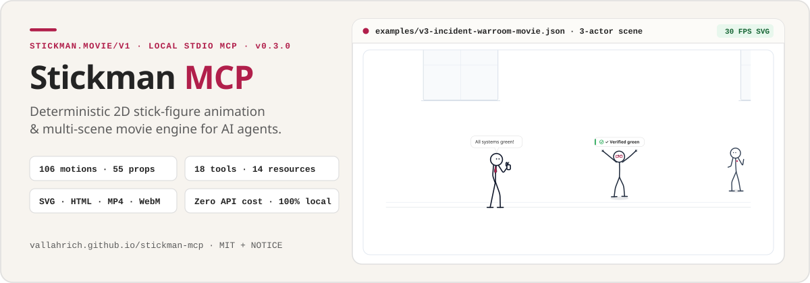

# Stickman MCP

[](https://github.com/vallahrich/stickman-mcp/releases/tag/v0.3.1)
[](LICENSE)
[](package.json)
[](https://vallahrich.github.io/stickman-mcp/)
[](https://vallahrich.github.io/stickman-mcp/#catalogue)

**Stickman MCP** is a deterministic local 2D stick-figure animation and multi-scene movie engine with an 18-tool stdio MCP server — zero AI video API cost, byte-identical SVG, HTML, GIF, MP4, and transparent VP9 WebM output on Node.js 20+.

> Every frame is a pure 30 fps function of validated JSON choreography (`stickman.animation/v1`, `stickman.animation/v2`, or `stickman.movie/v1`) — no remote rendering service, no model-weight calls, and no hidden network requests.
> Browse the [live interactive studio & 97-motion gallery](https://vallahrich.github.io/stickman-mcp/) or inspect the machine-readable [llms.txt](llms.txt) / [MCP Registry manifest](server.json).

---

## 30-Second Quick Start

### Option A — Install from the `v0.3.1` GitHub Release (no build required)

Download `vallahrich-stickman-mcp-0.3.1.tgz` from the [v0.3.1 release](https://github.com/vallahrich/stickman-mcp/releases/tag/v0.3.1):

```sh
npm install ./vallahrich-stickman-mcp-0.3.1.tgz
npx stickman discover --category presentation
npx stickman-mcp --root ./stickman-output
```

### Option B — Clone & Run from Source (Node.js 20+)

```sh
git clone https://github.com/vallahrich/stickman-mcp.git
cd stickman-mcp
npm install
npm run build
```

Run the CLI directly on the flagship examples:

```sh
# Browse actions, validate, and render a self-contained HTML movie preview
node dist/cli.js discover --category presentation
node dist/cli.js preview --input examples/v3-incident-warroom-movie.json --format html > warroom.html

# Generate an orthographic CAD blueprint contact sheet or export SVG/MP4/transparent WebM
node dist/cli.js storyboard --input examples/v2-two-actors-collab.json --blueprint > collab-blueprint.svg
node dist/cli.js export --input examples/v3-handoff-and-stairs.json --root ./output --output handoff.svg --format svg
```

Exports write strictly to new relative paths inside `--root`; overwrites, absolute paths, path traversal, and symlink directories are refused. Optional `@resvg/resvg-js` and FFmpeg (`ffmpeg-static` or `PATH`) enable GIF, MP4, transparent WebM, and PNG critique sheets; SVG, CAD blueprint, and HTML outputs need zero native binaries.

---

## Connect to Your AI Assistant (Copy-Paste MCP Config)

Replace the paths below with your reviewed checkout (or `node_modules/@vallahrich/stickman-mcp`) and an explicit `--root` export folder. See [docs/mcp-setup.md](docs/mcp-setup.md) for read-only tool subsets and verification steps.

### GitHub Copilot CLI

```sh
copilot mcp add stickman -- node "/path/to/stickman-mcp/dist/mcp.js" --root "/path/to/stickman-output"
```

### VS Code (`.mcp.json`)

```json
{
  "mcpServers": {
    "stickman": {
      "type": "stdio",
      "command": "node",
      "args": [
        "/path/to/stickman-mcp/dist/mcp.js",
        "--root",
        "/path/to/stickman-output"
      ]
    }
  }
}
```

### Claude Code

```sh
claude mcp add --transport stdio stickman -- node "/path/to/stickman-mcp/dist/mcp.js" --root "/path/to/stickman-output"
```

### OpenAI Codex CLI

```sh
codex mcp add stickman -- node "/path/to/stickman-mcp/dist/mcp.js" --root "/path/to/stickman-output"
```

---

## What You Can Build

| Capability | What Ships in `v0.3.1` |
|---|---|
| **Multi-Scene Explainer Movies** | Compose 1–16 sequential scenes (`stickman.movie/v1`) with contextual vector backdrops (`war-room`, `datacenter`, `office`, `stage`), `fade`/`wipe`/`cut` transitions, `auto-director` virtual camera, 2.5D `depth` planes, `spotlight: "auto"`, editorial `say`/`think`/`badge` callouts, and chapter-aware HTML, parallel H.264 MP4, or transparent VP9 WebM export. |
| **Multi-Actor Slide Overlays & `<stickman-player>`** | Stage cue-synced multi-actor scenes (`stickman.animation/v2`) using **106 runtime actions**, **55 geometric props**, curved Bezier spines, gaze cues, hand glyphs, shared `handoffTo` prop transfers, and inline `customMotions`. Embed via `<stickman-player controls scroll-scrub blueprint>` or `bindScrollTimeline`. |
| **CAD Dimensional Blueprints** | Render orthographic contact sheets and full-stage architectural blueprints (`--blueprint` / `--style blueprint`) with hatched geometry, dashed datum lines, anchor ticks, `144u` rig rulers, and automated bounds/overlap/seam lint. |
| **Self-Critiquing AI Workflows** | Run `stickman_critique` for 6-axis perceptual scoring (`Prop Integrity`, `Spatial Continuity`, `Staging & Eye-Trace`, `Pacing & Readability`, `Kinematic Appeal`, `Cinematography`) plus annotated SVG/PNG contact sheets and the `< 45 KB` interactive `ui://stickman/player` MCP App so agents iterate until `passed: true`. |

---

## Minimal Runnable Example (`stickman.movie/v1`)

Save as `handoff-movie.json` and run `node dist/cli.js preview --input handoff-movie.json --format html > handoff-movie.html` (or pass directly to `stickman_movie` / `stickman_critique`):

```json
{
  "version": "stickman.movie/v1",
  "title": "Release Handoff",
  "canvas": { "width": 1280, "height": 720, "fps": 30 },
  "trimIdleTails": true,
  "scenes": [
    {
      "id": "handoff",
      "title": "Handoff & Verify",
      "backdrop": "office",
      "camera": "auto-director",
      "spotlight": "auto",
      "actors": [
        {
          "id": "eng",
          "label": "Engineer",
          "x": 420,
          "depth": 0,
          "facing": "right",
          "accessory": "tie",
          "actions": [
            {
              "action": "hand-over",
              "handoffTo": { "actorId": "lead", "propType": "card", "propId": "release-card" },
              "say": "Release ready!",
              "emitCue": "passed"
            },
            { "action": "thumbs-up", "afterCue": "approved" }
          ]
        },
        {
          "id": "lead",
          "label": "Release Lead",
          "x": 820,
          "depth": 0.25,
          "facing": "left",
          "accessory": "glasses",
          "actions": [
            { "action": "catch", "afterCue": "passed", "emitCue": "caught" },
            { "action": "cheer", "afterCue": "caught", "badge": "✓ Shipped", "emitCue": "approved" }
          ]
        }
      ]
    }
  ]
}
```

---

## MCP Surface at a Glance

The stdio server exposes **18 tools**, **14 resources**, and **3 prompts** over strict JSON Schemas without type coercion:

| Group | Tools | Mode |
|---|---|---|
| **Discovery & Contracts** | `stickman_discover`, `stickman_describe`, `stickman_schema`, `stickman_story` | Read-only |
| **Choreography & Movies** | `stickman_validate`, `stickman_compile`, `stickman_choreograph`, `stickman_movie` | Read-only |
| **Review & Critique** | `stickman_storyboard`, `stickman_critique` | Read-only |
| **Preview & Export** | `stickman_preview` (read-only), `stickman_export` (`svg-frame`, `svg`, `html`, `storyboard-svg`, `gif`, `mp4`, transparent `webm`) | Preview / Writes under `--root` |
| **Continuous Films** | `stickman_list_film_assets`, `stickman_check_join`, `stickman_compose_film`, `stickman_render_film` | Read-only / Writes under `--root` |
| **Motion Authoring** | `stickman_author_motion`, `stickman_preview_motion` | Writes draft/strip under `--root` |

- **14 MCP Resources:** `stickman://catalog`, `stickman://schema/v1`, `stickman://schema/v2`, `stickman://schema/movie-v1`, `stickman://anchors`, `stickman://props`, `stickman://rubric/human-critique`, `ui://stickman/player`, and 6 starter templates (`stickman://templates/presentation-pitch`, `two-actor-dialogue`, `idea-reveal`, `sports-action`, `incident-warroom-movie`, `two-actor-handoff`).
- **3 MCP Prompts:** `choreograph-slide`, `two-actor-dialogue`, and `create-and-critique-movie`.

---

## When to Use / When Not to Use

| Use Stickman MCP When… | Choose Another Tool When… |
|---|---|
| You need **deterministic, repeatable 2D technical explainers** for architecture diagrams, slide decks, docs, or release demos. | You need photorealistic generative video, cinema VFX, or raster character artwork. |
| You want **zero per-render API cost**, instant local SVG/HTML/WebM builds, and strict diffable JSON source files. | You need real-time 3D skeletal rigging, ragdoll physics, or interactive game-engine collision worlds. |
| You want an **AI agent to choreograph, self-critique (`stickman_critique`), and iterate** inside a bounded `--root` workspace. | You need synchronized voiceover, TTS audio tracks, or music mixing (Stickman exports silent visuals). |
| You need **accessible reduced-motion/static fallbacks**, crisp vector scaling, and `< 220 KB` offline HTML players. | You need arbitrary unscripted contact mechanics outside the 106 runtime actions and 55 geometric props. |

---

## Documentation & Provenance

- **Setup & Integration:** [Local MCP Setup](docs/mcp-setup.md) · [Browser & `<stickman-player>` Integration](docs/browser-integration.md) · [Design System (`DESIGN.md`)](DESIGN.md)
- **Authoring & Production:** [Continuous Film Recipes](docs/film-recipes.md) · [Motion Authoring Guide](docs/motion-authoring.md) · [Release Verification](docs/releasing.md)
- **Machine-Readable Discovery:** [llms.txt](llms.txt) · [server.json](server.json) · [CITATION.cff](CITATION.cff) · [Live Gallery & Atom Feed](https://vallahrich.github.io/stickman-mcp/)
- **Licensing & Rights:** Original engine, authored key-pose specifications, and geometric vector props are released under [MIT](LICENSE). Compact CMU-derived motion clips retain CMU's non-resale dataset terms; optional `@resvg/resvg-js` and `ffmpeg-static` retain their respective licenses. See [NOTICE](NOTICE) and [docs/rights.md](docs/rights.md).
